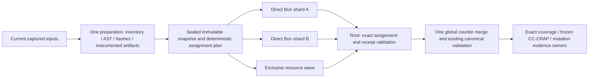

# Parallel testing architecture — reviewed design candidate

Status: design with scheduler implementation in progress; parallel coverage
is not implemented or qualified. Current
serial/historical protocols remain authoritative. User requested iterative
comparison and autonomous testing-architecture work; no new approval pause is
introduced. Root owns this document and final runtime/numeric verification.

## Evidence and intent

Reach a complete current test/coverage operation within600000ms while preserving
exact four-metric coverage, frozen CC/CRAP correspondence and assertion-confirmed
Killed semantics. Keep the5000ms per-test default and justified individual
exceptions. Build/install execute no suites. No new dependency is required.

Current published HEAD72eefda: full run66f78094-b5ba-4557-8625-c5bdece47caa
terminated UNKNOWN at600000ms,245PASS/8FAIL partial and no final numeric receipt.
Partial reporter body sums: runtime-config-rebind160rows/~414.5s; retirement
7rows/~97.3s; audit6rows/~40.0s; controller5rows/~26.2s. These are incomplete
body sums, not measured file durations, complete totals or predicted speedups.
Evidence: .tmp/coverage-iteration-72eefda/partial-timing-summary.json.

The largest observed file must be decomposed before file parallelism can
distribute its cases. No variant makes an individual blocking case faster.

## Iterative alternatives

| Iteration / combination | Benefit | Cost / failure boundary | Decision |
| --- | --- | --- | --- |
| Serial shared-global Bun + reduced fixture work | Existing receipt/ordering semantics; lowest overhead | One large file dominates; current full run remains incomplete | Keep as control and historical mode |
| Native `--parallel=2 --no-isolate` | Bun schedules files; imports reused within workers | Worker assignments are not bound by our protocol; preload finalization is once while Bun wraps hooks per file; shared globals remain | Do not enable through a flag change |
| Native `--parallel=2 --isolate` | Documented file isolation, coverage/JUnit merge and transpiled-code reuse | Same PID can execute multiple isolated files; current receipt validator forbids duplicate PID; selected-test and published-child proofs currently require the whole suite per process | Future alternative after bounded provenance/lifecycle qualification |
| Global `--concurrent` / `test.concurrent` | Can overlap independent async I/O within a file | Shared mocks, clocks, environment, fixtures and case-local assertion state; no CPU parallelism | Reject as global setting; later narrow opt-in only |
| Explicit disjoint shards, direct serial Bun children, concurrency2 | Assignments bound before launch; one process/receipt per shard; shared immutable snapshot/maps; existing serial preload lifecycle | Requires async child supervision and a versioned shard/merge contract; shared output conflicts and cross-file ordering still need qualification | Recommended first implementation candidate |
| Explicit shards + resource exclusivity + domain-file split | Distributes the observed large contour; fences shared resources; limits RAM/child fan-out | Domain extraction must preserve every case and fresh fixture ownership; no throughput guarantee before measurement | Target architecture, delivered incrementally |
| Per-shard package clone | Can isolate package resource locks if execution roots also change | Current logical module paths still resolve original package root; copies alone do not isolate reads. Root remapping needs new custody/module qualification and adds delivery/setup cost | Defer; do not copy merely to claim isolation |
| Explicit shards + qualified package-owned verified reads | Removes a demonstrated common read-side CAS writer while retaining fresh one-file observation | Requires focused data-reader qualification and existing resource digest/freshness fences; unsupported providers stay exclusive | Prerequisite before expanding private CLI/Host parallel eligibility |

Official docs establish Bun support, not VIDA qualification. Bun documents
replacement workers taking remaining files after a crash; do not assume automatic
replay of the crashed file, nor infer descendant cleanup from documentation.

## Target data flow

One orchestration run owns one reservation and one global selection. There are
multiple supervised direct producers inside that run, no competing full runs.
Each shard runs explicit `./` test paths with `--parallel=1 --no-isolate` and
the existing5000ms default. Within a shard, preserve serial semantics initially.
No automatic retry of an uncertain case or retained operation under another ID.

Preparation retains the existing Babel AST → inventory → test links → reviewed
scenario matrices pipeline, Ajv and instrumented Bun coverage. Transform once
in preparation; reuse sealed instrumented sources/maps in all shards. Final
canonical validation remains once globally, not once per shard. Reuse existing
input bytes/digests; do not introduce another full scan/hash/AST pass.

## Protocol and admission

Keep serial VidaBunCoverageRun/v2 and genuine legacy readers compatible. New
parallel manifests/receipts use an explicit new protocol version; never add
unvalidated optional shard claims to v2 or silently relax its checks.

The global plan binds run_id, full selected tests, ordered assignments, source /
test / tool fingerprints, existing configuration-input digests, runtime
executable digest, source-map/artifact bindings and exact argv/cwd/environment.
Each shard binds shard_id, ordinal/count, assigned_tests and an ordered
assignment digest to that global plan. The global test fingerprint keeps its
current meaning; a shard-selection fingerprint is additional evidence.
Global manifest.tests and test_selection.tests stay complete. Parallel preload
and per-process validators use assigned_tests for local completeness, verify
their membership in that global set and reject sibling test loads/claims.

Admission requires pairwise-disjoint assignments with exact union equal to
the full selection; all assigned tests loaded from captured inputs, no sibling
test claim, one valid terminal process receipt per shard, unique producer PID,
unchanged shared map/artifact bindings and known successful child outcomes.
Coverage-process receipts and supervisor terminal records remain distinct:
validate their run/shard/PID join; a coverage JSON file is not a terminal proof.
Each shard exclusively owns physical coverage/JUnit/log/receipt/temp output
paths beneath its run/shard root. Before launch, reject aliases, collisions and
paths into the common immutable snapshot/maps or another shard's outputs.
Child evidence may have sparse source keys: every observed key must match its
exact common instrumented map entry, with no foreign key, valid counter shapes,
finite nonnegative safe integers and checked sums without overflow. Seed the
global result once from the full sealed source map; merge each bound source key
across accepted shards, require exact full expected aggregate Source domain and
run global canonical validation once. No per-shard full Source loading is required.
Required counters are merged once.
Absent Source keys add no increments; unloaded seeded Source keeps zero counters
and still faces exact coverage gates. Preserve required per-process receipt and
loaded-module checks; absent data is not positive evidence.
Missing/foreign/stale/duplicate evidence,
failure or UNKNOWN prevents numeric admission. Module-load evidence remains
distinct from execution, coverage, assertions, properties and mutation results.

Reports bind unchanged function IDs and source/test/config hashes. Splitting
test files requires explicit test-ID/association updates and fresh test bindings;
preserve scenario meaning/names and review generated mappings. N/A needs a
rationale. No expected numeric result may be used to manufacture correspondence.

Historical published-baseline execution stays serial with its existing single
PID/JUnit/fixture-child binding. Current tests consuming historical fixtures
require separate resource/custody review; historical references are not replayed
operations. Aggregate JUnit alone is not worker provenance or a Killed proof.

## Scheduling and resources

Begin at concurrency2, never CPU-count fan-out by default. Increase only after
same-input measurements show lower wall time without worse tails, failures,
UNKNOWN, memory pressure or retention growth. Independent shard processes still
may spawn CLI children; monitor aggregate resources, not only shard count.

Use one bounded, deterministic assignment plan. The first scheduler sorts paths
and balances eligible file counts, with shard-index tie breaks; file counts are
not duration estimates. A later optional longest-file-first schedule needs
complete, same-scope per-file timing evidence. Partial reporter body sums cannot
provide those weights or establish performance/quality admission.

Fourth iteration compares resource-connected components against greedy ordered
waves. A component-only partition minimizes producer startup but unnecessarily
serializes independent files when a later file joins two resources.
The first scheduler keeps two serial batches and flushes a wave when a new file
would join resource owners from both batches. This preserves available overlap
without concurrent resource reuse. It is deterministic, not a proof of minimal
makespan. No timed optimizer, search engine or adaptive worker controller is
needed before the first qualified comparison. Resource-free files share batches
instead of launching a new process per file. Unknown files remain separate
exclusive pilot waves until review permits batching/parallel admission; do not
use a mostly unknown plan to claim a full-suite speed improvement.

Eligibility is opt-in and review-backed. Unknown resource ownership stays in
the exclusive wave. An exclusive file blocks other files that share its resource;
placing it in a named shard alone does not enforce exclusion. Fresh temporary
roots/DBs/outputs are owned per case. Shared package outputs, Git worktrees,
published fixture coverage directories and runtime activation require exclusivity
until disjointness is qualified. Mock/global ordering dependencies need separate
controls; filesystem exclusivity does not prove module isolation.
Eligibility binds captured test bytes plus the existing global input/runtime/
platform/package-root review scope. Unchanged test bytes alone cannot preserve
a resource review after Source or dependency/provider behavior changes.
The plan has ordered waves; each wave contains nonconflicting shard assignments.
Unknown/global-exclusive files form singleton waves, with all other producers
settled before launch. The supervisor advances a wave only after accounting its
children and proving the affected resources safe to reuse; no second shard can
overlap a singleton exclusive wave. Keep separate predicates for direct producer
termination/coverage reservation release and resource-wave advancement. A passing
exit, released coverage lock, absent PID/marker or issued cleanup signal cannot
prove descendant/effect quiescence. Missing resource custody proof stops wave
advancement and retains UNKNOWN; do not broaden the direct reservation's scope.
Assignments with overlapping shared resource IDs cannot occupy the same wave.
Tests sharing a resource may be batched inside one assignment because its Bun
producer runs every test serially. Enabling internal concurrent scheduling would
invalidate that assignment contract. Resource IDs use `namespace:<sha256>`:
a lowercase bounded namespace and lowercase64-hex digest of the canonical
physical owner identity from existing captured metadata. Caller derives identity
from the qualified owner, rather than hashing arbitrary path spellings; raw path
IDs are denied. Review scope still binds provider/platform and package-root
identity. The pure scheduler performs no new filesystem identity/hash pass.

Third review iteration found an actual shared read-side resource: runtimePackageAccess
derives the current package root from module URLs and reads package.json via
readText. Linux readBytes acquires an exclusive CAS sidecar and rejects overlapping
readers. The preload currently preserves original module paths/resolveDir; private
consumer roots do not isolate this package root. runtime-config-rebind also reads
its package initialization schema and prewriter template. Tag affected contours
with `runtime-package-root:<owner-sha256>` and serialize them initially.

Before widening eligibility, qualify a shared package-only reader using the
existing verified-capture primitive: no read-side CAS writes, fresh bounded bytes,
single-link/no-follow/root/file identity and active-lock/recovery checks preserved.
Mutable consumer config/Source readers remain unchanged. Reuse existing captured
tool-input digests for schemas/templates/instructions and current package identity/
resource fences; no extra scan/hash rebuild or cross-invocation stale cache.
This is pending work, not evidence that private CLI cases already overlap safely.

Candidate waves: pure contracts/math/codecs/properties; static inventory/matrix
tooling; private config/CLI/Host fixtures; bounded native FS/recovery fixtures.
Keep real runtime/system activation outside this pilot and numeric readiness.

Split runtime-config-rebind by behavior: Source rebind, delivered configuration,
readonly UNKNOWN bookkeeping, historical context/recovery, compact JSON/storage
limits. Extract only shared fixture construction/inspection into one test helper;
each case retains a fresh root and state. Preserve exact case count/names,
denials/no-effects, operation IDs and phase membership. Do not share mutable DBs
or weaken Source/authorization/CAS/durable sync to speed setup.

## Deadline, failure and retention

The600000ms target applies to the qualified pinned test/coverage command:
required typecheck, preparation, test waves, terminal accounting, report validation
and the CRAP subprocess currently nested in run-bun-coverage.ts. Move required
typecheck into this existing command owner before preparation; eliminate the
separate shell pre-step. Start one monotonic deadline at command entry; every
launch/wait consumes remaining
time, never a fresh600000ms allowance. Preserve existing cleanup/report reserves
inside that deadline; if no allowance remains, retain UNKNOWN/unattempted proof.
Never pass timeout0 to a native child as an expired deadline: it can disable the
timeout. Spent allowance prevents launch, including the nested CRAP stage.
CRAP retains its300000ms upper bound, clamped to remaining global time/reserves,
and its existing owner/lock semantics. Mutation remains a separately invoked
admission stage, with no inferred ten-minute guarantee for the full mutation
campaign. Record public Bun bootstrap and pinned-command durations separately;
do not claim a caller-level ten-minute pass merely from child elapsed time.

Await and record every direct child terminal outcome; stream per-shard logs.
The single acquired run reservation releases once only after every launched
direct producer is accounted for under TESTING's exact predicates. An unknown/
unobserved producer keeps it held despite passing siblings. An exact not-started
result accounts for that launch alone, never for an already launched child.
Known direct termination is distinct from success, descendant/effect cleanup
and reservation release. Reuse TESTING's exact release predicates; unknown
termination must not free a conflicting reservation. Account all siblings on
timeout/failure and retain incomplete roots/receipts. A missing PID or passing
replacement is insufficient. No archival UNKNOWN replay.

## Bounded acceptance ladder

1. Pure assignment controls: exact union/disjointness, stable order, bounds,
   resource exclusion and stale/missing/foreign binding denial.
2. Two independent tiny files with one snapshot: serial and two-shard outputs
   preserve counters, selected test identities and terminal receipt semantics.
   Use the existing explicitly untrusted structural-fixture owner for this
   bounded pilot. Real execution of a fixture proves its behavior/custody, not
   full current measurement. Do not add a partial selector that can publish an
   admitted current report or reinterpret synthetic counters as genuine coverage.
3. Failure controls: omitted/duplicate/sibling test, duplicate PID, stale digest,
   altered map/counter, ordinary failure, crash/missing receipt, surviving
   descendant, timeout with active sibling, output collision and mock/order leak.
4. Domain extraction: prove every old case occurs exactly once with equivalent
   assertions/phase membership; evaluate tests and qualification under Root.
5. Expand reviewed contours; run one complete current selection. Require all
   tests PASS and full coverage/report admission within600000ms. Frozen and
   assertion-confirmed mutation gates remain mandatory and independently pending.

Stop expansion on provenance gaps, collision, changed assertions/case set,
memory/timeout regressions or unaccounted descendants. Retain serial mode; do
not quietly rerun failed shards or admit an incomplete union. Compare serial
and parallel using identical immutable captured input bytes/pin/instrumentation/
resource scope but distinct run IDs and disjoint output roots;
report observed wall, per-file/test tails and resource costs without projections.
The synthetic pilot qualifies only assignment, child custody and receipt/merge
mechanics in that fixture. It cannot authenticate counters against adversarial
in-process test code or establish trusted general Source measurement.

References: https://bun.com/docs/test/parallel.md,
https://bun.com/docs/test/runtime-behavior.md,
https://bun.com/docs/test/code-coverage.md, https://bun.com/blog/bun-v1.4.3;
current TESTING.md, bun-test skill and the10-minute cycle plan.
